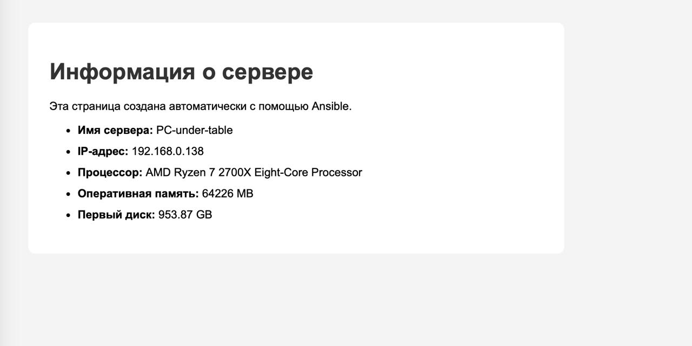
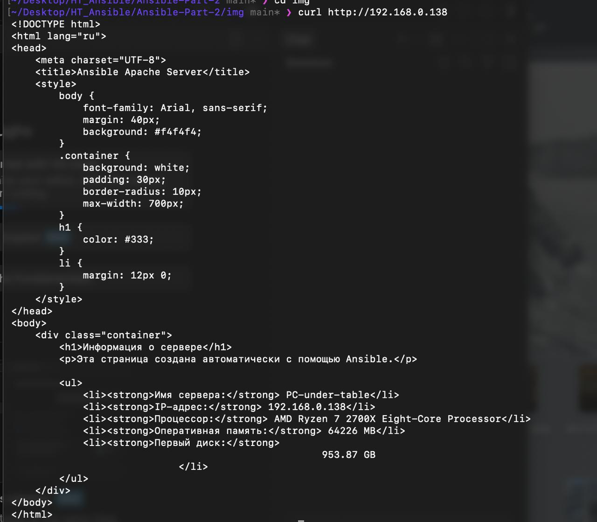
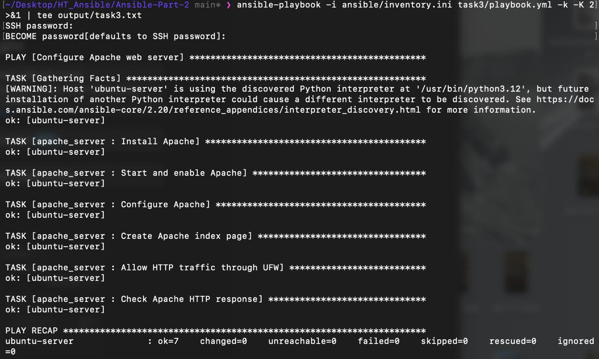

# Ansible Part 2 — Макаров Николай

## Задание 1. Playbooks

В первом задании подготовлены три playbook:

1. `task1/download_archive.yml` — скачивание и распаковка архива.
2. `task1/install_tuned.yml` — установка, запуск и включение службы `tuned`.
3. `task1/motd.yml` — настройка приветственного сообщения с использованием переменной.

Результаты выполнения:

- [Лог скачивания и распаковки архива](output/task1-download.txt)
- [Лог настройки MOTD](output/task1-motd.txt)
- [Лог установки tuned](output/task1-tuned.txt)

## Задание 2. Информация о сервере в MOTD

Playbook `task2/motd_info.yml` настраивает приветственное сообщение на управляемом сервере. В сообщении используется информация об IP-адресе и hostname сервера, а также пожелание хорошего дня.

[Лог выполнения задания 2](output/task2.txt)

## Задание 3. Роль Apache

Для настройки веб-сервера создана роль `apache_server`.

Роль выполняет следующие действия:

- устанавливает Apache;
- запускает и включает службу Apache;
- создаёт конфигурационный файл;
- генерирует главную страницу сайта с помощью Jinja2-шаблона и Ansible facts;
- разрешает HTTP-трафик на порту 80 через UFW;
- проверяет доступность сайта с помощью модуля `uri` и ожидает HTTP-код `200`.

Перезапуск Apache выполняется handler `Restart Apache`, который вызывается при изменении конфигурационного файла.

Основные файлы роли:

- `tasks/main.yml`
- `handlers/main.yml`
- `templates/index.html.j2`

Архив роли: [apache_server.tar.gz](archives/apache_server.tar.gz)

### Результаты







[Лог выполнения задания 3](output/task3.txt)

## Запуск playbook

Playbook запускаются из корня проекта с использованием inventory:

```bash
ansible-playbook -i ansible/inventory.ini task1/download_archive.yml
ansible-playbook -i ansible/inventory.ini task1/install_tuned.yml
ansible-playbook -i ansible/inventory.ini task1/motd.yml
ansible-playbook -i ansible/inventory.ini task2/motd_info.yml
ansible-playbook -i ansible/inventory.ini task3/playbook.yml
```

Перед запуском роли Apache архив роли должен быть распакован в каталог `roles/apache_server`, если роль ещё не установлена в используемый Ansible путь ролей.

